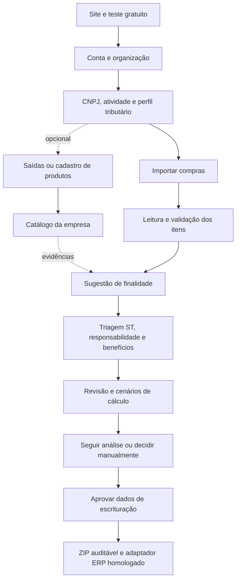

# Portal Inteligente de DIFAL — Especificação consolidada

**Versão:** 1.4 — consolidação para desenvolvimento.  
**Data:** 10/11/2026.  
**Projeto:** Oliveira Contabilidade — nome comercial definitivo a definir.  
**Destinatário:** programador, equipe de engenharia ou agente de desenvolvimento.  
**Idioma e mercado:** português do Brasil; operação inicial com destino ao Rio de Janeiro.  
**Natureza da entrega:** requisitos funcionais, técnicos e comerciais; não é software implementado, contrato aprovado por advogado nem base fiscal integral homologada.

## 0. Como utilizar esta especificação

Este é o documento principal do pacote. Consolida o comando mestre, os adendos 1.2 e 1.3 e as solicitações sobre ST, escolhas manuais e contratos. Os documentos de `historico/` são preservados para rastreabilidade e não devem ser implementados como três projetos separados.

**Ordem de leitura:** `00_LEIA_ME.md` → este documento → `02_ENTREGAS_E_TESTES.md` → `03_FONTES_E_PENDENCIAS.md` → materiais de `apoio/`.

**Prevalência:** esta versão prevalece sobre redações anteriores nos requisitos de produto. Legislação aplicável e homologação profissional prevalecem sobre exemplos ou premissas dos arquivos. Nenhuma tabela de demonstração ganha validade fiscal por estar neste ZIP.

**Estados de entrega a usar:** `implementado_e_testado`, `demonstracao`, `pendente_homologacao_fiscal`, `pendente_revisao_juridica`, `pendente_integracao`, `nao_implementado`. Uma tela pronta não prova funcionamento do backend.

As referências `[Fxx]`, `[Jxx]` e `[Txx]` apontam para `03_FONTES_E_PENDENCIAS.md`. Regras aqui definidas como requisitos de produto não são apresentadas como imposições legais universais.

## 1. Objetivo e proposta de valor

Construir um SaaS: site com assinatura, login individual, múltiplos clientes por escritório e isolamento de dados. O usuário importa XMLs de compras; o portal sugere a finalidade de cada item, verifica possíveis obrigações de DIFAL, sinaliza retenção relevante pelo remetente, identifica benefícios fiscais candidatos, calcula cenários e prepara dados aprovados para escrituração.

O diferencial comercial reúne **identificação por contexto + prevenção de duplicidade + benefícios fiscais + memória de cálculo + integração contábil**. O sistema apoia a revisão; não promete enquadramento infalível, economia garantida ou aceitação automática pelo Fisco.

O usuário pode discordar da sugestão e registrar sua decisão. A plataforma conserva separadamente documentos originais, recomendação técnica, cenário calculado e escolha final do cliente.

## 2. Comando de execução para o programador

> Desenvolva o Portal Inteligente de DIFAL segundo esta especificação. Entregue aplicação funcional com frontend, backend, persistência, permissões, migrações, testes e instruções de execução. Trabalhe por etapas, começando por cadastro, empresas, quotas do teste e importação de entradas.
>
> Não limite a entrega a protótipo visual. Não invente fundamento legal, alíquota, NCM, benefício, responsabilidade, CFOP ou compatibilidade com ERP. Separe classificação sugerida, motor fiscal determinístico e revisão humana. Dados ausentes produzem pendência, não imposto zero.
>
> Preserve o XML fiscal original byte a byte. A escrituração ajustada deve ser entregue em arquivos auxiliares/adaptadores homologados, nunca como NF-e autorizada adulterada. Permita escolhas manuais identificadas sem apagar a análise automática.
>
> Implemente prevenção de duplicidade por retenção, biblioteca versionada de benefícios, avisos visíveis, teste gratuito de três CNPJs e cinco NF-e de entrada por CNPJ, cobrança recorrente e contratos de prazo mínimo configuráveis. Nenhuma regra fiscal ou cláusula contratual não homologada será ativada silenciosamente em produção.
>
> Ao concluir cada etapa, informe o que funciona, quais testes foram executados e quais dependências permanecem. As pendências fiscais não impedem construir o fluxo técnico; impedem anunciar o cálculo como fiscalmente homologado.

## 3. Escopo inicial e limites

### 3.1 Incluído na primeira versão comercial

- Site comercial, teste gratuito, autenticação e organizações com empresas clientes.
- Cadastro operacional e tributário por estabelecimento, com validade temporal.
- XMLs de entrada e ZIPs; XMLs de saída e planilha de produtos opcionais.
- Classificação e revisão por item; sugestões justificadas.
- DIFAL de aquisição interestadual para uso/consumo e ativo por contribuinte, inicialmente para destino RJ, dentro das regras efetivamente homologadas.
- Triagem de ST/DIFAL-ST, responsabilidade e retenção para evitar duplicidade.
- Benefícios fiscais candidatos, começando pelo Convênio ICMS 52/91; cenários e confirmação.
- Escolha manual de inclusão/exclusão de DIFAL e parâmetros manuais, com histórico.
- CFOP de escrituração por item, relatórios e ZIP de exportação auxiliar.
- Planos por capacidade; contratação mensal, semestral, anual ou negociada; renovação conforme política aceita.
- Administração de regras, auditoria, segurança e suporte.

As funcionalidades essenciais de ST, revisão manual e benefício não são descartadas para acelerar o lançamento. Podem ser entregues em etapas, mas a oferta comercial deve refletir o que estiver homologado.

### 3.2 Não presumir incluído

DIFAL nas vendas a consumidor final não contribuinte; cálculo geral de ICMS-ST com MVA de todas as UFs; emissão ou pagamento de GNRE/DARJ; transmissão de EFD; recuperação automática de indébito; apuração de IBS/CBS; emissão/correção de NF-e; captura de documentos com certificado; lista completa nacional de benefícios; compatibilidade com todos os ERPs.

Esses módulos podem ser futuros. A triagem de ST no MVP não significa que o produto já calcule qualquer operação de substituição tributária.

UF, regime ou operação ainda não atendidos geram `fora_do_escopo_homologado`, com possibilidade de registro manual separado. Não aplicar a fórmula RJ a outra UF por conveniência.

## 4. Decisões consolidadas

| Tema | Regra de produto |
|---|---|
| Conta | Cadastro como escritório contábil ou pessoa física/profissional; pessoa jurídica também pode contratar para uso próprio |
| Organização | A conta contratante possui seu espaço isolado; pessoa física pode administrar empresas autorizadas |
| Teste | Até 3 estabelecimentos/CNPJs; até 5 NF-e de entrada válidas e únicas por CNPJ; até 15 ao todo |
| CNPJs do teste | Vínculo não substituível pelo usuário para reiniciar cotas; demais dados cadastrais podem ser corrigidos com histórico |
| Cartão CNPJ | Upload disponível; cadastro manual confirmado é alternativa, sem dependência exclusiva de API externa |
| Saídas e produtos | Opcionais; sua ausência nunca bloqueia a análise de entradas |
| Classificação | Por item e contexto; NCM, CNAE e histórico são evidências, não conclusões isoladas |
| ST | Verificar a identidade da obrigação e a responsabilidade antes de afastar recolhimento adicional |
| Decisão manual | Incluir/excluir DIFAL, com justificativa, autor, data e valores anteriores/finais |
| Benefício | Candidato + requisitos + comparação de cenários; confirmação específica e aviso para consultar o contador |
| Exportação | XML original preservado + informações de escrituração em arquivos separados |
| Preços | Valores e descontos ainda configuráveis; faixas antigas eram ilustrações, não tabela aprovada |
| Prazo contratual | Independente da periodicidade de cobrança; preparar 6 e 12 meses e contrato negociado |
| Renovação | Continuidade sem nova fidelidade no fluxo padrão; prorrogação por igual período apenas em modelo revisado e aceito |
| Regras oficiais | Versionadas, com competência, fonte e homologação; ausência de regra não equivale a zero |

## 5. Jornada e telas

### 5.1 Jornada principal



### 5.2 Site público

Página inicial com apresentação, funcionamento, demonstração fictícia, benefícios, planos, dúvidas frequentes, segurança, contato, termos e política de privacidade. Botão principal: **Teste gratuito**.

Não anunciar “DIFAL sempre correto”, “restituição garantida” ou “XML fiscal corrigido”. Texto comercial sugerido: **Identifique possíveis incidências, revise retenções e prepare a escrituração com memória de cálculo.**

### 5.3 Área autenticada

Menu: Painel; Minhas empresas; Importar entradas; Importar saídas; Base de produtos; Análises e revisão; DIFAL e benefícios; Exportações; Assinatura e contrato; Configurações.

Na empresa selecionada, os botões **Importar entradas** e **Importar saídas — opcional** ficam lado a lado. Informar cotas disponíveis, documentos em processamento e competência de trabalho.

### 5.4 Tela de revisão por item

Colunas mínimas: nota/item; produto; NCM; UF; finalidade sugerida/final; justificativa; ST/retenção; benefício; DIFAL automático; FECP; decisão manual; valor final escolhido; CFOP de entrada; status; revisor.

Painel lateral: dados originais, evidências, memória de cálculo, cenários, requisitos pendentes, histórico e anexos. Valores estimados, revisados e manuais devem ter rótulos diferentes.

Filtros: empresa, competência, fornecedor, UF de origem, NCM, CFOP, finalidade, possível benefício, retenção a conferir, decisão manual e pendência.

## 6. Contas, permissões e empresas

### 6.1 Modelo de identidade

Uma organização (`tenant`) pode representar escritório, empresa ou profissional. Usuário autenticado pertence a uma ou mais organizações, com contexto selecionado e autorização no servidor. Cada empresa cliente é um estabelecimento vinculado à organização, e não uma nova assinatura obrigatória.

Não impor unicidade global de CNPJ entre organizações: dois escritórios podem tratar dados da mesma empresa em ambientes isolados. Nunca compartilhar documentos por coincidência de CNPJ.

### 6.2 Perfis

| Perfil | Acesso principal |
|---|---|
| `owner` | Organização, equipe, contratação e administração autorizada |
| `admin` | Empresas, usuários e operações, conforme delegação |
| `analyst` | Importar, analisar e propor alterações |
| `reviewer` | Aprovar classificação, benefício, escolha manual e exportação |
| `billing` | Plano, contrato e pagamentos; sem acesso fiscal automático |
| `read_only` | Consultas expressamente permitidas |
| `platform_tax_reviewer` | Homologar catálogo fiscal global; não é papel comum do cliente |

A mesma pessoa pode acumular papéis, com registro. Autenticação de usuário não comprova habilitação profissional. Usar “revisado pelo usuário” e não “parecer de contador” quando a qualificação não tiver sido verificada.

E-mail verificado, recuperação segura e MFA disponível. Exigir MFA para administração sensível e publicação de regras em produção. Proibir conta de suporte com acesso irrestrito permanente aos dados dos clientes; acesso excepcional deve ser autorizado, limitado e auditado.

### 6.3 Cadastro do estabelecimento

CNPJ, razão social, nome fantasia, UF, município, inscrição estadual, condição de contribuinte do ICMS, CNAE principal/secundários, regime e datas de vigência. Aceitar cartão CNPJ em PDF e dados digitados ou obtidos por integração autorizada. Sempre solicitar conferência do usuário.

O CNPJ não determina sozinho o regime, a condição de contribuinte ou a destinação de cada aquisição. Registrar a origem de cada informação e sua data. Se extração do cartão falhar, permitir confirmação manual; OCR é fallback, não requisito do produto.

CNPJ armazenado como texto de 14 posições; aceitar o formato numérico e o alfanumérico segundo a Receita Federal, preservando zeros. A especificação oficial mantém as duas últimas posições numéricas e permite letras/números nas anteriores. Usar validador versionado e testes oficiais. Não remover letras por uma máscara antiga. [F06]

### 6.4 Questionário operacional por caixas/cartões

Perguntar: varejo, atacado, indústria, serviços, alimentos, construção, agro ou outro; revende produtos? fabrica? usa matérias-primas? usa embalagens? compra ativo? comercializa máquinas? trabalha com ST? vende e usa internamente o mesmo produto?

Exibir perguntas dependentes da resposta, com opção **Não sei / solicitar revisão**. CNAE serve de apoio, sem impor finalidade automática. Guardar perfil por vigência e preservar o perfil usado em cálculos anteriores.

## 7. Teste gratuito e controle de utilização

### 7.1 Regras fechadas

Até 3 CNPJs distintos vinculados por organização e 5 NF-e de entrada válidas/únicas por CNPJ. Reimportar a mesma chave não consome cota. Um ZIP com cinco NF-e válidas conta cinco documentos, não um arquivo.

O limite é por documento aceito, não por número de itens ou quantidade de execuções. Saídas para catálogo não consomem a cota de cinco entradas, mas possuem limites técnicos/antiabuso próprios.

Arquivo inválido, modelo não suportado, destinatário incompatível ou duplicata não consome cota. Erro técnico de processamento não deve gerar cobrança nem cota dupla. Nota válida já analisada e depois cancelada mantém o registro de uso do teste; não vira mecanismo de reciclagem.

### 7.2 Vínculo e correções

Após confirmação, o usuário não substitui livremente o CNPJ para reiniciar a avaliação. Pode corrigir nome, atividade e outros dados sem trocar a identidade do estabelecimento. Correção legítima de CNPJ exige atendimento, justificativa e auditoria.

Excluir/arquivar empresa não devolve automaticamente vaga de teste. Atender solicitações de privacidade de acordo com política aprovada; não prometer retenção eterna de identificadores para antiabuso. Eventual marcador residual deve ser mínimo, ter finalidade/base e prazo documentados.

### 7.3 Implementação transacional

Reservar vaga/cota em transação no backend, com chave única e controle de concorrência. Após validação, consolidar uso; em falha, liberar reserva. Duas importações simultâneas não podem ultrapassar o limite.

Chave lógica do documento: organização + estabelecimento + chave de acesso. Upload idêntico retorna o registro existente. Mesmo identificador com conteúdo diferente não substitui o original: registrar variante/quarentena e solicitar revisão.

Padrão inicial de produto: avaliação sem cartão e sem migração automática para cobrança. Não foi definido prazo comercial de expiração; implementar parâmetro opcional, sem inventar encerramento em 7/14/30 dias. A contratação paga exige aceite próprio.

## 8. Importação, leitura e preservação dos documentos

### 8.1 Tipos aceitos

NF-e modelo 55 em XML, protocolo quando disponível, eventos suportados e ZIPs de XML. Um XML sem protocolo pode servir para inspeção, mas deve conservar o status correspondente; não presumir autorização.

NFC-e, NFS-e, CT-e, devoluções, retornos, remessas, transferências, bonificações e outras operações não são compras comuns por padrão. Identificar e direcionar para regra específica ou pendência.

Preservar data de emissão, data de entrada quando informada, data do evento e competência. A regra fiscal escolhe a data relevante; não usar a data do upload como fato gerador.

### 8.2 Campos mínimos

Cabeçalho: chave, modelo, série, número, `dhEmi`, natureza, `tpNF`, `idDest`, `finNFe`, referências, emitente/destinatário, UF/município, IE, `CRT`, `indIEDest`, protocolo e status declarado.

Item: `nItem`, `cProd`, descrição, NCM, CEST, GTIN, unidade, quantidade, preço, `vProd`, `vDesc`, `vFrete`, `vSeg`, `vOutro`, IPI, CFOP do emissor, origem, CST/CSOSN, base, redução, alíquota e ICMS próprio. Ler, quando presentes, grupos de ST/FCP, retenções anteriores, ICMSUFDest, `cBenef` e informações complementares.

Distinguir campo ausente de valor explicitamente zero. Preservar o valor original e o valor normalizado, com localização no XML. Campo não reconhecido deve ser conservado no original e gerar alerta quando relevante ao cálculo.

### 8.3 Validação e status

Verificar integridade estrutural, modelo, destinatário, totais, itens e eventos. Interpretar CFOP/`tpNF` primeiro pela ótica do emitente; só depois definir a escrituração do destinatário.

Separar: estrutura válida; assinatura verificada/não verificada; autorização declarada no protocolo; situação consultada na SEFAZ; cancelamento conhecido. Sem integração de consulta, exibir a limitação e não afirmar situação atual confirmada. Arquivo com protocolo original não prova ausência de cancelamento posterior.

Usar schemas/leiautes oficiais e versionados. Chave de acesso é texto; validar formato conforme versão do documento, sem reaproveitar indiscriminadamente uma expressão regular de CNPJ numérico.

### 8.4 Arquivo original e segurança

Armazenar bytes originais, nome de origem, tamanho, tipo detectado, SHA-256, organização, empresa, autor e data. Storage privado e download autorizado. Nunca reformatar, remover assinatura ou reescrever o original. [F01]

Limitar tamanho, número de arquivos, expansão total, profundidade e tempo de processamento. Impedir XXE, expansão de entidades, zip bomb, zip slip, caminhos absolutos, arquivos executáveis e extensões disfarçadas. Não executar macros ou fórmulas importadas.

Processamento em lote usa fila e workers, com tentativas limitadas, progresso, erros por arquivo e reexecução idempotente. Um erro não perde os arquivos válidos do mesmo lote.

## 9. Catálogo opcional de produtos e saídas

Aceitar XMLs de saída e planilha `.xlsx`, com modelo de importação a ser implementado. Colunas: `codigo_interno`, `descricao`, `ncm`, `cest`, `gtin`, `categoria`, `finalidade_padrao`, `observacoes`.

Mostrar prévia, mapeamento de colunas, validações e erros por linha antes de confirmar. Excel não deve executar conteúdo nem converter automaticamente códigos em números. Exportações tabulares devem neutralizar injeção de fórmulas em descrições/textos.

Catálogo por estabelecimento; código do fornecedor deve ser identificado em seu contexto, não tratado como SKU universal. Usar GTIN válido, alias confirmado, descrição e atributos para sugerir correspondências. NCM igual não prova produto igual.

Guardar fonte (`xml_saida`, `xlsx`, `manual`), data, documento, versões e eventuais divergências. Aprender somente com decisões aprovadas daquela organização; não transferir dados fiscais identificáveis entre clientes.

Produto vendido também pode ser consumido internamente. O catálogo melhora a sugestão, mas não determina a destinação de cada compra. A ausência de catálogo nunca bloqueia a análise de entradas.

## 10. Classificação explicável por item

### 10.1 Finalidades

`revenda`, `industrializacao_insumo`, `embalagem`, `uso_consumo`, `ativo_imobilizado`, `outras_operacoes`, `indeterminado`.

Separar finalidade econômica, hipótese tributária e CFOP. Uso/consumo não é sinônimo de DIFAL devido; aquisição para revenda não exclui toda e qualquer obrigação estadual, que poderá estar fora deste módulo.

### 10.2 Sequência

1. Identificar natureza da operação e limites do escopo.
2. Carregar perfil da empresa válido na data pertinente.
3. Consultar decisão específica anterior e catálogo facultativo.
4. Confrontar produto, características, descrição, fornecedor, NCM e atividade.
5. Produzir sugestão, evidências e confiança da classificação.
6. Pedir confirmação quando houver conflito ou ambiguidade.

Uma loja de roupas comprando vassoura pode receber sugestão de uso/consumo; não decisão fiscal irrevogável. Embalagem ou máquina exige contexto. Produto com histórico de revenda continua podendo ser destinado a uso interno.

A confiança é da classificação, não uma probabilidade de respaldo legal. Não exibir percentuais arbitrários como se fossem medidas estatísticas calibradas; inicialmente podem ser níveis alto/médio/baixo com critérios documentados.

### 10.3 Quantidades e operações mistas

NF-e mista tem classificação por item. Se um mesmo item tiver destinação parcial, permitir alocações internas com quantidades/valores reconciliados, sem alterar o XML. Na etapa em que o desdobramento ainda não estiver disponível, manter o item pendente em vez de atribuir toda a quantidade à mesma finalidade.

Toda alocação aponta ao `nItem` original, registra método de rateio, preserva soma e evita duplicidade. A integração ERP só exporta desdobramento se seu layout homologado suportar; caso contrário, sinalizar limitação.

## 11. ST, DIFAL-ST e prevenção de recolhimento duplicado

### 11.1 Objetivo específico

Atender o problema relatado pelo proprietário: compras nas quais o remetente já assume/retem imposto pertinente podem receber novo DIFAL indevidamente na apuração do destinatário. O sistema deve encontrar esse risco e oferecer evidências para revisão, não presumir que toda ST elimina qualquer DIFAL. Matriz jurídica a homologar por operação, UF e competência. [F03]

### 11.2 Evidências a extrair

Ler os campos de ST do item e dos totais, incluindo, quando existentes, `vBCST`, `pICMSST`, `vICMSST`, `vFCPST`, `vBCSTRet`, `vICMSSTRet`, `vFCPSTRet`; preservar grupos próprios e informações complementares. Os grupos exatos dependem da versão do schema e do CST/CSOSN.

CEST, CFOP, CST/CSOSN, expressão “ST”, presença de um protocolo citado ou acréscimo no total da NF-e são pistas, não comprovação isolada de identidade da obrigação. Valores de retenção anterior não devem ser confundidos automaticamente com retenção desta operação.

Conservar documentos auxiliares quando enviados: guia, comprovante, declaração, referência de convênio/protocolo, inscrição do remetente e outros elementos. Arquivo anexado pode estar pendente de conferência; não recebe status de prova válida por simples upload.

### 11.3 Quatro dimensões independentes

| Dimensão | Pergunta |
|---|---|
| Incidência | Qual obrigação existe para esta finalidade/operação? |
| Responsabilidade | Remetente, destinatário ou outro sujeito é responsável no caso concreto? |
| Retenção | Há destaque/retenção referente à mesma obrigação, item, destino e período? |
| Pagamento | Existe evidência de recolhimento efetivo e qual seu alcance? |

**Destaque no XML não é sinônimo de pagamento comprovado.** Por outro lado, a ausência de guia individual não autoriza cobrar novamente do destinatário quando a regra homologada atribui responsabilidade ao remetente e os demais fatos estão satisfeitos. Manter estados distintos para cada conclusão.

### 11.4 Fluxo de decisão

1. Identificar se os dados permitem falar em ST, DIFAL-ST ou outro recolhimento.
2. Conferir regra aplicável por mercadoria/descrição, acordo entre UFs quando exigido, vigência, regime, destinação e exceções.
3. Identificar responsável e hipótese precisa abrangida pela retenção.
4. Vincular evidência aos itens/parcelas correspondentes; não espalhar a ST de um item para toda a NF-e.
5. Calcular eventual obrigação comparável pela regra homologada.
6. Concluir: sem adicional do destinatário; adicional a verificar; retenção insuficiente/incompatível; pendência; fora de escopo.
7. Registrar decisão do usuário sem apagar os fatos ou a análise.

### 11.5 Estados sugeridos

`sem_indicio`, `retencao_identificada_a_conferir`, `responsabilidade_remetente_confirmada`, `retencao_correspondente_confirmada`, `pagamento_documentado`, `retencao_incompativel`, `diferenca_a_revisar`, `pendente`.

Esses estados pertencem a campos separados quando puderem coexistir. Não usar uma única flag `st=true` como decisão tributária final.

### 11.6 Resultado e avisos

Exibir imposto calculado do cenário, responsável, retenção informada, parcela reconhecida e eventual valor adicional do destinatário em linhas separadas. Não usar universalmente `DIFAL - toda ST da nota`; compensação/dedução depende de regra e correspondência.

Quando a análise não comportar subtração numérica, mostrar a conclusão de responsabilidade e a razão de não haver adicional, em vez de simular crédito. Não deduzir a mesma evidência em dois cenários finais ou em dois documentos.

Texto de alerta:

> **Retenção identificada — conferir antes de recolher novamente.** O XML contém informações de ICMS-ST ou tributo relacionado. Confirme se a retenção e a responsabilidade abrangem esta operação, seus itens e a obrigação analisada. O destaque, isoladamente, não comprova o recolhimento efetivo.

Possível duplicidade é alerta, não indébito reconhecido nem crédito disponível. Recuperação/compensação permanece fora do escopo inicial.

## 12. Decisão manual do cliente

### 12.1 Interface obrigatória

Na revisão de cada item:

```text
[ ] DIFAL manual — por escolha do usuário

Quando marcado, escolher:
( ) Incluir DIFAL manualmente
( ) Excluir DIFAL manualmente

Motivo: [obrigatório]
Observação / documento de apoio: [campo]
Valores e parâmetros: [conforme a decisão]
[Confirmar decisão] [Voltar à análise do sistema]
```

A caixa nasce desmarcada. O padrão é **Seguir análise do sistema**, que ainda exige as revisões previstas. Inclusão manual pode utilizar o cálculo disponível ou valores próprios, com identificação da origem de cada valor. Exclusão manual não apaga o valor originalmente calculado.

### 12.2 Separações obrigatórias

- Finalidade do item: decisão sobre uso/revenda/ativo etc.
- Benefício: aplicar, não aplicar, pendente.
- Retenção/responsabilidade: conclusão revisada e evidências.
- DIFAL: seguir análise, incluir manualmente ou excluir manualmente.
- CFOP/valores de escrituração: aprovação específica para exportação.

Alterar um desses controles não confirma silenciosamente os demais. Escolher “excluir DIFAL” não confirma automaticamente ausência de FECP; mostrar o tratamento de ambos e exigir definição coerente. O mesmo vale para inclusão.

### 12.3 Auditoria e permissões

Guardar usuário, organização, empresa, documento/item/alocação, data/hora, ação, motivo, anexos, resultado anterior/final, parâmetros, versões de regra/aviso e hash do cenário.

A aplicação em lote exige seleção explícita, prévia de quantidade/valores e confirmação. Não se propaga automaticamente a compras futuras do mesmo NCM. Oferecer regra privada de preferência somente por consentimento separado e com escopo claro; ela não altera o catálogo legal.

Reprocessamento conserva a decisão antiga e marca `revalidacao_necessaria` se fatos, regra ou valores mudarem. Reverter à análise cria novo evento; não exclui a trilha.

### 12.4 Pendências e exportação

Se faltar regra legal ou dado indispensável, a análise automática permanece pendente. O usuário pode registrar decisão manual e valor, mas o sistema não os reclassifica como conclusão legal homologada.

Permitir exportação auxiliar de decisão manual por usuário com permissão, com rótulo **MANUAL — ESCOLHA DO USUÁRIO**, premissas e aviso. Erros estruturais, de segurança, documento cancelado conhecido ou layout incompatível não são contornáveis por checkbox; gerar relatório/ajuste específico quando cabível.

## 13. Motor de cálculo fiscal

### 13.1 Separação de módulos

Criar motor independente da interface e da IA. Distinguir `difal_aquisicao_contribuinte`, `difal_st`, `fecp` e cenários de benefício. O módulo de venda a não contribuinte não está habilitado no MVP.

Fórmulas “por dentro” e “por fora” não são opções equivalentes à vontade do usuário. A regra por operação/UF/competência escolhe o método; simulação alternativa fica marcada como manual. [F02, F03]

### 13.2 Entradas e saídas

Entradas: estabelecimento/perfil, datas relevantes, UFs, finalidade, valores do item e encargos, base e ICMS de origem, alíquotas nominais, cargas efetivas, benefício, FCP/FECP, responsabilidade, evidências e política de arredondamento.

Saídas: status, modalidade, composição da base, etapas matemáticas, ICMS-DIFAL, FECP, valores informados/retidos, eventual adicional, cenário, requisitos, fundamentos, versões e avisos.

Manter distintos: imposto destacado na origem, imposto retirado da base, parcela deduzida na fórmula, carga efetiva e alíquota nominal. Não presumir igualdade universal entre essas grandezas.

### 13.3 Precisão e memória de cálculo

Usar decimal exato; proibir `float` na origem de resultados fiscais. Percentuais internos usam fração decimal explicitada (`0.12` para 12%). Valores e taxas trafegam como strings decimais; banco usa `numeric` com escala definida. Moeda exibida em pt-BR.

Registrar política de arredondamento por operação, componente, item, documento e competência. Não arredondar intermediários por conveniência visual. Somar componentes arredondados quando a regra assim determinar e exibir eventual diferença com o arredondamento do total.

Rateios de frete/despesas precisam de critério aprovado e reconciliação; se o XML já trouxer o valor por item, não adicioná-lo novamente. `vNF` não deve ser usado indiscriminadamente como base de cada item.

Divisor inválido, dados incompatíveis, falta de fonte ou conflito de regras produzem erro/pendência. Resultado negativo não vira crédito ou restituição automática. Não ocultar inconsistência com `max(0, valor)` indiscriminado.

### 13.4 Regras versionadas

Cada regra: identificador, modalidade, UF origem/destino, regime, condições, exceções, referências, fórmula, arredondamento, início/fim de efeitos, publicação, ratificação quando cabível, implementação estadual quando exigida, revisor, data e status.

Estados: rascunho → em revisão → homologada → suspensa/encerrada. Regra publicada é imutável; alteração cria versão. Identificar conflitos/sobreposições antes da ativação. “Mais favorável” não resolve conflito legal automaticamente.

Catálogo de normas é global com administração restrita. Decisões e dados de empresas são privados por organização. Publicação fiscal deve exigir revisão distinta da edição em produção, ou controle compensatório documentado se a equipe for pequena.

### 13.5 Aprovação e recálculo

Separar **regra homologada pela plataforma** de **operação revisada pelo cliente**. Cálculo final exige versão válida e aprovação dos fatos. Manual permanece manual.

Recálculo não sobrescreve execução aprovada; cria nova versão, mostra diferenças e solicita revisão quando necessário. Não gerar ou pagar guia automaticamente neste escopo.

## 14. Biblioteca de benefícios fiscais

### 14.1 Primeiro conjunto

Começar pelo Convênio ICMS 52/1991, seus Anexos I e II e regras estaduais pertinentes. O ato trata de equipamentos industriais e implementos agrícolas e possui cláusula específica para diferencial. A conclusão por operação depende dos requisitos e da vigência, não apenas do NCM. [F04]

A base JSON fornecida contém **10 enquadramentos e 9 NCMs distintos**. É amostra de identificação/testes, não a íntegra dos anexos nem cadastro homologado. Todos os registros continuam desativados para cálculo automático.

### 14.2 Cadastro mínimo

Ato, cláusula, anexo, item/subitem, expressão NCM original, código normalizado, tipo de correspondência, descrição integral, resumo, condições herdadas do grupo, características, exclusões, operação, UF, regime, destinação, datas e fonte.

Guardar publicação, efeitos, ratificação, implementação estadual e última conferência separadamente. Páginas consolidadas podem conter redações históricas; o importador não pode ativar todas simultaneamente.

Mesmo NCM pode ter enquadramentos diferentes. Preservar todos os candidatos e condições; não escolher automaticamente o menor imposto. Não estender benefício a todo capítulo, parte/acessório ou NCM sucessor presumido.

### 14.3 Elegibilidade e resultado

Fluxo: localizar candidato → confrontar descrição/características → aplicar contexto/competência → pedir evidência faltante → calcular cenário quando possível → obter decisão específica.

Status: `nao_identificado`, `candidato`, `pendente`, `confirmado_para_o_cenario`, `nao_aplicavel`, `suspenso`. Presença ou ausência de `cBenef` não encerra, sozinha, a análise.

Para as situações tratadas nos adendos, manter testes de operações a 4%, cargas favorecidas e eventual tratamento de FECP no RJ. As consultas anteriores servem de referência focal; a aplicação produtiva depende de revisão do contexto e das normas na competência. Não cadastrar “52/91 = zero” nem “benefício + 2% automático”. [F02, F05, F08]

### 14.4 Dois cenários

**A — Referência sem aplicação do benefício.**  
**B — Benefício condicionado ao enquadramento.**

Usar os mesmos fatos de partida e destacar as premissas que mudarem. Apresentar bases, ICMS-DIFAL, FECP, responsabilidade, retenção reconhecida e adicional ao destinatário separadamente.

Se o benefício for efetivamente aplicável, A é comparação contrafactual, não dívida alternativa confirmada. O usuário não deve ser induzido a entender que pagar mais torna o enquadramento correto.

Rótulo da diferença: **Diferença potencial entre cenários**. Não chamar de economia comprovada ou crédito recuperável sem evidências e análise própria.

### 14.5 Vigência futura

O adendo anterior mencionou o Convênio 131/2026 e a necessidade de conferir eficácia/ratificação e implementação. Este pacote não libera automaticamente 2027/2028. Registrar os atos e validar a cadeia aplicável antes de ativar regras para novo período. A existência de texto publicado não substitui essa revisão. [F09]

## 15. Avisos ao usuário e confirmação

### 15.1 Texto principal a implementar

> **Possível benefício fiscal — validação necessária**  
> A plataforma identificou uma hipótese de benefício fiscal com base nos dados informados. Sua aplicação depende da confirmação dos requisitos legais, das características do produto e das condições da operação.  
> **Antes de reduzir ou dispensar o recolhimento, consulte seu contador ou responsável técnico.** Esta indicação não substitui a análise profissional nem representa homologação pelo Fisco.

Exibir junto do benefício, antes da confirmação e nos relatórios com a hipótese. Não esconder apenas em termos de uso. O próprio contador usuário pode revisar dentro de suas permissões; não exigir outro profissional para cumprir mecanicamente o aviso.

### 15.2 Caixa inicialmente desmarcada

> Revisei os requisitos e as informações desta operação e confirmo a aplicação deste cenário. Estou ciente de que a identificação automática não comprova, por si só, o direito ao benefício.

Ações: **Aplicar benefício**, **Não aplicar benefício**, **Manter pendente**. A ciência se vincula ao cenário/itens selecionados e à versão do texto. Requisitos desconhecidos não se tornam verdadeiros porque a caixa foi marcada.

### 15.3 Texto de escopo para revisão jurídica

> A plataforma é uma ferramenta de apoio à análise e à escrituração fiscal. As sugestões utilizam documentos e parâmetros disponíveis e devem ser conferidas pelo contratante ou responsável técnico antes de sua utilização em obrigações fiscais. O contratante deverá fornecer informações corretas e registrar as decisões manuais que adotar. A plataforma manterá identificados os cenários, as premissas e as versões das regras utilizadas. Esta disposição não exclui responsabilidades legalmente atribuídas à fornecedora, inclusive por falhas próprias do serviço, nem implica renúncia a direitos do contratante.

Não usar exoneração irrestrita de responsabilidade. O CDC, quando aplicável, impõe limites à exclusão de responsabilidade; o checkbox não sana erro próprio de cálculo ou publicidade. Submeter contratos e comunicação comercial a revisão jurídica. [J01]

## 16. Planilha de referência recebida

Arquivo original em `apoio/PLANILHA_MODELO_DIFAL_ORIGINAL.xlsx`, renomeado no pacote apenas para facilitar os caminhos; o conteúdo deve permanecer idêntico ao enviado. Abas: **POR DENTRO** e **POR FORA**.

Não executar a planilha como motor de produção nem considerar suas fórmulas prova de validade fiscal. Ela orienta a comparação e os testes após revisão técnica/tributária.

**Achados registrados no adendo 1.2, preservados para revisão do programador:**

| Referência | Achado e providência |
|---|---|
| `POR DENTRO!F9` | `=E9/(1-0.22)` contém 22% fixo; substituir constante por parâmetro da regra, depois da homologação |
| ICMS de origem | Modelo calcula valor da operação × alíquota; sistema precisa conservar também base reduzida, imposto efetivo e dedução aplicável |
| `POR DENTRO!E35` | `=SUM(Tabela1[VALOR DA OPERAÇÃO SEM ICMS])-B35`; adendo registrou R$ -1.154,16 versus soma da coluna de R$ 8.463,87; revisar totalização e filtros |
| Fórmulas compartilhadas | Expandir corretamente ao ler o XLSX; célula sem fórmula literal própria pode integrar fórmula compartilhada |
| Observações K9/K10 | Não converter observações simplificadas sobre regime/destaque em regras legais universais |

O achado de E35 não prova, isoladamente, erro no total final do DIFAL. Nesta consolidação, os achados foram transportados do adendo; a planilha não foi alterada nem submetida a nova homologação integral.

**Teste aritmético didático:** valor 1.000,00; origem 120,00; recomposição ilustrativa 22%; componentes 20% e 2%. Base = 880 / 0,78 = 1.128,205128…; diferencial ilustrativo = 105,641025…; FECP ilustrativo = 22,564102… . Arredondar componentes separadamente resulta em 105,64 + 22,56 = 128,20; arredondar apenas o total não arredondado resulta em 128,21. A política deve ser explícita. Esses percentuais são dados de teste, não alíquotas de produção.

O arquivo `apoio/CASOS_ARITMETICOS_DEMONSTRACAO.json` documenta exemplos matemáticos e divergência de arredondamento. Não contém regras fiscais aprovadas.

## 17. CFOP de escrituração e exportação

### 17.1 Separação essencial

`issuer_cfop`: CFOP original emitido pelo fornecedor; intocável no documento.  
`bookkeeping_cfop`: CFOP de entrada proposto/aprovado para o destinatário.

A tabela de correspondência considera finalidade, operação, UFs, ST e regras vigentes. Não implementar simples troca do primeiro dígito. Códigos genéricos não prevalecem sobre hipótese específica. Toda alteração deve ter motivo, usuário e versão.

**A exportação solicitada como “XML ajustado” será realizada como ajuste de escrituração, sem modificar a NF-e autorizada.** Uma NF-e assinada alterada não deve ser apresentada como documento fiscal original válido. [F01]

### 17.2 ZIP gerado pelo produto

```text
exportacao_<empresa>_<competencia>_<id>/
  LEIA_ME.md
  originais/<chave>.xml
  escrituração/entrada_itens.csv
  apuracao/memoria_calculo.csv
  apuracao/demonstrativo.xlsx
  beneficios/cenarios_e_requisitos.csv
  retencoes/evidencias_e_responsabilidades.csv
  decisoes/escolhas_manuais.csv
  pendencias/itens_nao_aprovados.csv
  auditoria/manifesto.json
  erp/<adaptador_homologado>/...             # somente quando disponível
```

Nomes de diretórios efetivos podem usar ASCII para facilitar compatibilidade. O ZIP acima é o formato do futuro produto, não o conteúdo documental desta entrega ao programador.

### 17.3 Campos de integração

Identificar chave, item/alocação, número/série, CNPJ, competência, produto, NCM, CFOP emitente, CFOP entrada aprovado, finalidade, quantidade, valores, cenário, DIFAL, FECP, retenção, decisão manual, status, revisor e versão.

Decimais em layout técnico têm formato declarado. CSV pode usar `;` e UTF-8, mas o adaptador define explicitamente convenção de decimal/encoding. Não depender da configuração regional do computador do cliente.

### 17.4 Notas parcialmente aprovadas

XML é exportado inteiro e original. Mapeamento marca todos os itens e distingue aprovados/pendentes. Não inserir CFOP padrão silenciosamente em item pendente.

Para integração direta, bloquear nota parcial se o ERP não comportar importar os dados com segurança. Relatório de conferência pode ser gerado sem aprovação integral, com rótulo de pendência. Exportação final não deve levar usuário a pensar que apenas itens aprovados existem no XML original.

### 17.5 Adaptador ERP

Escolher primeiro ERP e obter layout/arquivo real, versão e ambiente de teste. Implementar interface `ErpExportAdapter` com validação, geração e relatório de limitações. O nome de um ERP citado em conversa não basta para afirmar compatibilidade.

Arquivo XML auxiliar proprietário é admissível se o layout do ERP o exigir, claramente identificado como arquivo de importação, sem falsa assinatura/protocolo ou apresentação como NF-e autorizada. Não gerar `nfeProc` adulterado com CFOP de entrada.

Homologação exige importar no ERP, conferir itens/tributos/CFOPs e documentar resultado. O MVP pode entregar ZIP genérico antes disso, mas a oferta não deve anunciar integração direta pronta.

## 18. Painel, relatórios e indicadores

Painel por empresa/período: entradas importadas; itens revisados/pendentes; documentos cancelados conhecidos; possíveis incidências; valores automáticos revisados; valores manuais; FECP; retenções a conferir; benefícios candidatos; exportações.

Totais devem separar: estimativa, decisão revisada, manual e pendência. Não somar alternativas A e B como duas obrigações. Em relatório consolidado, usar somente o cenário final selecionado por item e informar o que ficou fora.

Para o administrador do negócio, medir uso, custos de processamento, conversão do teste, assinaturas, inadimplência e suporte. Não expor faturamento/contratos de uma organização a outra.

## 19. Planos, preços e contratação

### 19.1 Quatro eixos independentes

1. Capacidade: CNPJs, documentos por período, usuários, recursos e suporte.
2. Cobrança: mensal ou antecipada pelo período contratado.
3. Prazo mínimo: sem fidelidade adicional, 6 meses, 12 meses ou negociado.
4. Renovação: política aceita e juridicamente revisada.

Um contrato anual pode ser pago mensalmente; isso não o torna mensal sem fidelidade. Quotas mensais não se tornam anuais nem acumuláveis por pagamento antecipado, salvo oferta expressa.

### 19.2 Modalidades

| Modalidade | Compromisso | Oferta |
|---|---|---|
| Mensal flexível | Ciclo contratado, sem multa de fidelidade | Preço padrão aprovado |
| Semestral | 6 meses, configurável | Desconto aprovado; cobrança mensal ou antecipada |
| Anual | 12 meses, configurável | Desconto aprovado; cobrança mensal ou antecipada |
| Empresarial negociado | Prazo do instrumento | Proposta individual versionada |

Nomes de capacidade sugeridos: Inicial, Escritório, Profissional e Empresarial. Preços, descontos, volumes pagos, reajustes e multas continuam pendentes de aprovação. Não usar as faixas ilustrativas do comando 1.0 como tabela comercial vinculante.

Manter qualidade fiscal, segurança e auditabilidade iguais; diferenciação comercial não autoriza retirar proteções essenciais de planos mais baratos.

### 19.3 Checkout

Mostrar capacidade, modalidade, preço de referência verdadeiro, desconto, preço contratado, cobrança, desembolso imediato, total do prazo inicial, início/fim do compromisso, renovação, preço após o prazo, cancelamento, multa se aprovada e devoluções.

Em pagamento antecipado, destacar total cobrado e também equivalente mensal, sem induzir que a cobrança é mensal.

Aceites separados e não pré-marcados para contrato e ciência de prazo/renovação quando aplicável. Marketing é opcional. Confirmar identidade/poderes de quem contrata; um checkbox não substitui todos os requisitos de validade.

Disponibilizar cópia imutável da versão aceita, com identificação, data, hash e comprovante. Alterar modelo de contrato não reescreve contratos já aceitos. [J01, J03]

## 20. Renovação automática e cancelamento

### 20.1 Continuidade padrão

Política: `continuous_service_without_new_commitment`.

Após o prazo inicial, o serviço/cobrança podem continuar nas condições informadas e aceitas, sem nova fidelidade silenciosa. Novo compromisso com desconto exige confirmação específica. Não elevar preço por surpresa.

Texto-base sujeito à revisão:

> Encerrado o prazo mínimo inicial, a assinatura continuará ativa nas condições de continuidade informadas na contratação, salvo solicitação de cancelamento. A continuidade do serviço não cria, por si só, novo prazo mínimo. A adesão a novo período de permanência com desconto será objeto de confirmação específica.

### 20.2 Prorrogação por igual período

Política: `fixed_term_auto_renewal_reviewed`.

Preparar tecnicamente para contratos empresariais negociados, mas manter desabilitada até aprovação jurídica do modelo e aceite destacado. Informar prazo renovado, preço/reajuste, desconto, oposição, cancelamento e eventual multa. Ter CNPJ não afasta automaticamente a possível aplicação do CDC. [J01, J04]

Não publicar cláusula com campos em aberto. O sistema deve bloquear ofertas incompletas, e não preencher prazo de oposição, índice ou multa com números arbitrários.

### 20.3 Notificações

Painel mostra término, próxima renovação e prazo de oposição. Lembretes devem ocorrer antes do prazo de oposição, e não apenas antes da cobrança. Dias de antecedência são parâmetros contratuais aprovados, não norma legal geral deste documento.

Registrar conteúdo, canal, destinatário, tentativas e entrega quando disponível. Falha relevante de aviso exigido encaminha a renovação para revisão; não cria automaticamente nova multa/fidelidade. Continuidade de acesso/cobrança segue a política aceita, sem presumir gratuidade ou extinção.

### 20.4 Eventos distintos

- **Não renovar:** encerra a renovação futura; mantém direitos até o término aplicável.
- **Cancelar antecipadamente:** solicita encerramento antes do fim; exige tratamento contratual próprio.
- **Inadimplência:** falha financeira; não equivale a pedido de cancelamento.
- **Arrependimento/devolução:** tratamento legal específico quando aplicável.

Registrar protocolo da solicitação mesmo se houver disputa sobre valores. Não tornar o cancelamento tecnicamente impossível por multa pendente.

### 20.5 Multas e direitos

`cancellation_fee_policy = pending_legal_approval` até aprovação de fórmula, base, teto, proporcionalidade, exceções e condições. Não cobrar automaticamente todas as mensalidades restantes como regra universal nem acumular penalidades pelo mesmo fato sem análise.

Código Civil, arts. 412–413, orienta os limites da cláusula penal. Direito de arrependimento de sete dias deve ser preservado nas hipóteses de consumo à distância a que se aplica; o teste gratuito não o elimina por si só na contratação paga. Tratar falha da fornecedora e direitos de devolução separadamente. [J01, J02]

### 20.6 Mudança de plano

Upgrade, downgrade e reajuste não reiniciam prazo mínimo silenciosamente. Documentar alteração, preço, efeitos nas quotas e aceite necessário. Não apagar documentos ao exceder a nova capacidade; definir restrição de novas operações, leitura e exportação segundo política de retenção/contrato.

## 21. Cobrança, pagamentos e conciliação

Criar abstração `BillingProvider`; preferência de integração inicial: Mercado Pago Assinaturas, sujeita à conta, funcionalidades e documentação vigente. Alternativa pode ser escolhida por decisão técnica documentada. [T01]

Checkout em ambiente seguro, sem armazenamento de cartão completo/CVV. Credenciais somente no servidor. A assinatura financeira, o contrato e o direito de acesso são entidades diferentes.

Webhooks com verificação de origem/assinatura conforme provedor, idempotência, ordenação, tentativas e conciliação por API. A tela de retorno do checkout não comprova pagamento. Evento repetido não duplica cobrança, contrato, prazo mínimo ou multa.

Estados próprios: pagamento, assinatura, contrato, acesso e renovação. Exemplo: contrato em vigor com cobrança vencida não implica pagamento aprovado; pagamento aprovado não cria novo compromisso contratual por si só.

Antes de cobrar renovação, verificar pedido de não renovação, versão contratual e elegibilidade. Usar lock/transação para corrida entre webhook, agendamento e cancelamento. Manter fila de reconciliação para eventos inconclusivos.

Emissão fiscal da receita SaaS depende da entidade vendedora e configuração própria. Comprovante do gateway não deve ser anunciado como NFS-e. Tratar integração de emissão como requisito operacional a definir antes da venda, sem presumir incluída no motor de DIFAL.

## 22. Arquitetura de referência

Proposta técnica, não obrigação de usar versões obsoletas ou serviço específico:

- Web: Next.js + TypeScript, componentes acessíveis e Tailwind CSS.
- Banco: PostgreSQL com isolamento por organização; Supabase pode atender Auth/Storage/RLS.
- Processamento: worker separado e fila confiável; Redis/BullMQ ou equivalente gerenciado.
- Storage: objetos privados, hashes, URLs assinadas e política de retenção.
- Cálculo: biblioteca decimal e funções puras versionadas, sem IA na aritmética.
- Integrações: adaptadores para cobrança, cadastro CNPJ e ERP.
- Operação local: Docker Compose ou equivalente documentado, migrações e `.env.example` sem segredos.

Escolher versões estáveis/suportadas na implementação e fixar dependências em lockfile. Consulta externa indisponível não deve destruir o fluxo: informar status e permitir os dados manuais previstos. Isolamento por RLS não dispensa autorização de API/worker/storage. [T02]

Estrutura sugerida:

```text
apps/web/                 # telas e endpoints
apps/worker/              # importação, análise, exportação, notificações
packages/domain/         # entidades e serviços de negócio
packages/nfe-parser/     # leitura segura e versionada
packages/classifier/     # sugestões explicáveis
packages/tax-engine/     # cálculo determinístico
packages/rules/          # schemas e publicação de regras
packages/billing/        # contratos e adaptadores de pagamento
packages/erp-adapters/   # geração de layouts específicos
packages/shared/         # tipos, validações e serialização decimal
infra/                   # infraestrutura e migrações
tests/                   # unitários, integração, regressão, segurança, e2e
docs/                    # execução, decisões, regras e homologações
```

## 23. Modelo de dados consolidado

Tabelas abaixo são referência lógica; nomes podem mudar sem perda de entidades. Todas as tabelas de dados de clientes têm `tenant_id`, vínculos consistentes e políticas de acesso. Catálogos globais têm escopo e papéis próprios.

| Grupo | Entidades principais |
|---|---|
| Identidade | `organizations`, `users`, `memberships`, `roles`, `company_permissions` |
| Empresas | `companies`, `company_activity_profiles`, `company_tax_profiles`, `company_documents` |
| Utilização | `trial_company_slots`, `usage_ledger`, `usage_reservations`, `plan_limits` |
| Produtos | `products`, `product_aliases`, `product_sources`, `product_decision_history` |
| Documentos | `import_batches`, `source_documents`, `invoice_headers`, `invoice_items`, `item_allocations`, `invoice_events`, `import_errors` |
| Classificação | `classification_suggestions`, `item_reviews`, `item_classification_decisions` |
| ST | `retention_evidence`, `retention_allocations`, `responsibility_assessments`, `retention_reviews` |
| Regras | `tax_sources`, `tax_rules`, `tax_rule_versions`, `tax_rates`, `tax_formulas`, `rounding_policies` |
| Benefícios | `benefit_catalog_entries`, `benefit_catalog_versions`, `benefit_state_rules`, `benefit_validity_events`, `item_benefit_matches`, `item_benefit_evidence`, `item_benefit_decisions` |
| Cálculo | `tax_runs`, `tax_scenarios`, `tax_item_results`, `tax_calculation_steps`, `tax_run_approvals` |
| Manual | `manual_tax_decisions`, `manual_parameter_values`, `decision_versions` |
| Avisos | `disclaimer_versions`, `benefit_acknowledgements`, `user_acknowledgements` |
| Escrituração | `cfop_mapping_rules`, `item_bookkeeping_decisions`, `erp_adapters`, `export_jobs`, `export_manifests` |
| Comercial | `plans`, `plan_versions`, `offers`, `offer_versions`, `subscriptions`, `payment_events`, `billing_reconciliations` |
| Contratos | `contract_templates`, `contract_versions`, `customer_contracts`, `contract_acceptances`, `subscription_terms`, `renewal_events`, `renewal_notices`, `cancellation_requests`, `cancellation_settlements` |
| Auditoria | `audit_events`, `processing_jobs`, `data_retention_requests`, `security_incidents` |

### 23.1 Campos transversais

UUID/ID estável; `created_at`, `updated_at`; autor; revisão; status; `tenant_id`/`company_id` quando aplicável; chaves externas com integridade e índices. IDs enviados pelo cliente não substituem verificação do tenant.

CNPJ/NCM/CEST/chave são textos. Valores são decimais. Datas de fato gerador não devem ser deslocadas de dia por conversão ingênua de fuso; timestamps operacionais usam UTC e apresentação em America/Sao_Paulo/configuração da organização.

### 23.2 Registro mínimo de escolha manual

```json
{
  "schema_version": "1.0",
  "item_id": "id-interno",
  "action": "exclude_difal",
  "reason": "Motivo registrado pelo usuário",
  "technical_result_id": "resultado-original-preservado",
  "selected_scenario_id": "cenario-revisado",
  "icms_difal_manual": "0.00",
  "fecp_manual": "0.00",
  "tax_status": "manual_user_choice",
  "rule_version_id": null,
  "disclaimer_version_id": "aviso-v1",
  "acknowledged": true
}
```

Exemplo de payload, não regra fiscal. `tenant_id`, autor, data e permissões são derivados/validados no servidor. A ausência de regra não deve ser interpretada como homologação. Os campos de FECP são preenchidos após revisão específica.

### 23.3 Campos mínimos do contrato

Plano/oferta/contrato versionados; periodicidade; prazo mínimo; datas inicial/atual de início/fim; política de renovação; prazo de oposição; preço base/contratado; desconto; total inicial; regra de preço após prazo; reajuste; multa/revisão jurídica; aceites; cancelamento; eventos de pagamento.

Não guardar esses valores apenas em texto livre ou no gateway. O sistema precisa reproduzir exatamente a oferta aceita.

## 24. Serviços e APIs

Validar schemas, autorização, idempotência e controle de concorrência. Paginar listas e restringir filtros ao escopo autorizado.

| Operação | Rota lógica sugerida |
|---|---|
| Empresas e perfis | `GET/POST /api/companies`; `PATCH /api/companies/:id` |
| Importação | `POST /api/imports/entries`, `/exits`, `/product-sheet`; `GET /api/imports/:id/status` |
| Produtos | `GET /api/products`; `PATCH /api/products/:id` |
| Classificação | `POST /api/items/:id/classification-review` |
| Retenção | `POST /api/items/:id/retention-evidence`; `POST /api/items/:id/retention-review` |
| Benefícios | `GET /api/items/:id/benefit-candidates`; `POST /api/items/:id/benefit-decision` |
| Manual | `POST /api/items/:id/manual-tax-decision`; `POST /api/items/:id/manual-tax-decision/revoke` |
| Cálculo | `POST /api/tax-runs`; `GET /api/tax-runs/:id`; `POST /api/tax-runs/:id/approve` |
| CFOP | `POST /api/items/:id/bookkeeping-review` |
| Exportação | `POST /api/exports`; `GET /api/exports/:id/status`; `GET /api/exports/:id/download` |
| Oferta/contratação | `GET /api/offers`; `POST /api/contracts/accept`; `GET /api/contracts/current` |
| Pagamento | `POST /api/billing/checkout`; `POST /api/billing/webhooks/:provider` |
| Renovação | `GET /api/subscription/renewal`; `POST /api/subscription/non-renewal` |
| Encerramento | `POST /api/subscription/cancellation-quote`; `POST /api/subscription/cancellations` |
| Administração | Rotas separadas para propostas, regras, homologação, publicação e suspensão |

Serviços: `ImportService`, `ClassificationService`, `RetentionAssessmentService`, `BenefitEligibilityService`, `TaxCalculationService`, `ManualDecisionService`, `BookkeepingExportService`, `ContractAcceptanceService`, `RenewalEligibilityService`, `RenewalNoticeService`, `CancellationService`, `BillingReconciliationService`.

Documentar API e estados no repositório. Requisição de cliente com valor divergente de preço, quota ou regra não deve prevalecer sobre cadastro/contrato autenticado no servidor.

## 25. Segurança, privacidade e operação

### 25.1 Isolamento e arquivos

Testar acesso cruzado por ID/URL, consulta, worker, exportação, storage e assinatura de download. `tenant_id` vem do contexto autenticado, não de confiança no payload. Buckets privados, URLs temporárias, criptografia de trânsito/repouso e gestão de segredos.

Tokens privilegiados não ficam no frontend. Logs não devem conter XML completo, documentos pessoais, cartões ou segredos. Backups criptografados e restauração ensaiada.

### 25.2 IA e tratamento de dados

Classificador inicial pode ser determinístico. IA opcional limita-se a sugestões e explicações a partir de evidências. Descrições de produtos e arquivos são conteúdo não confiável: não executar instruções embutidas nem permitir acesso a outros tenants por prompt injection.

Não enviar documentos identificáveis a terceiros/provedores de IA sem avaliação contratual, finalidade, base aplicável e configuração apropriada. Minimizar dados; não usar dados de clientes para treino/compartilhamento global por padrão.

Mapear os papéis de controlador/operador por finalidade; não pressupor papel único em tudo. Termos, política de privacidade, autorização de uso dos documentos e contrato de tratamento precisam de revisão. Dados fiscais podem conter dados de pessoas naturais. [J05]

### 25.3 Retenção e saída

Definir retenção por classe de dado, direitos de acesso/exportação, descarte, backups e exceções legais. Imutabilidade significa não sobrescrever a evidência enquanto retida; não significa retenção infinita contra política/lei.

Cancelamento comercial não deve apagar imediatamente arquivos. Expor prazo de acesso/retirada e política aprovada. Ambiente de demonstração usa dados sintéticos; original do usuário não vira fixture pública.

### 25.4 Confiabilidade

Métricas: tempo e falhas de importação, filas, divergências de cálculo, regras vencidas, eventos de pagamento, avisos de renovação e exportações. Alertas não devem vazar dados.

Processo para erro fiscal/software: identificar versões afetadas, suspender regra se necessário, preservar histórico, avisar usuários impactados e oferecer reprocessamento comparativo; não corrigir retrospectivamente sem registro.

Separar desenvolvimento, homologação e produção. Publicação com CI, migrações, rollback e checklist. Definir metas de disponibilidade, recuperação e suporte antes de prometer SLA.

## 26. Padrões de interface

Português claro, responsivo, acessível, moeda BRL e datas brasileiras. Visual profissional: espaços bem definidos, hierarquia e cores discretas; não depender apenas de cor para status.

Mensagens orientam ação: “Informe a finalidade”, “Retenção a conferir”, “Regra não homologada para esta competência”, “Decisão manual registrada”. Evitar telas que exibam zero quando o cálculo não existe.

Confirmação antes de aprovar lote, aplicar preferência futura, recalcular fechado, contratar prazo mínimo ou alterar renovação. Exibir valores e efeitos reais, não alertas genéricos sem contexto.

## 27. Entregas, critérios de pronto e dependências

Executar etapas e testes de `02_ENTREGAS_E_TESTES.md`. Ao final de cada etapa: código, migrações, testes, instruções, evidências do fluxo e lista de limitações.

**Desenvolvimento pode começar agora:** telas, autenticação, empresas, quotas, importação, catálogo, revisão, auditoria, contratos parametrizados e estrutura do motor.

**Dependências que bloqueiam ativação, não toda a programação:** regras por operação/competência; testes fiscais aprovados; catálogo integral revisado; ERP e layout; preços/quotas pagos; política contratual aprovada; domínio, contas, suporte e privacidade.

O sistema não pode ser anunciado como “cálculo fiscal homologado” por reproduzir apenas a planilha ou exemplos deste pacote. Homologação fiscal, revisão jurídica e importação ERP são marcos independentes, documentados por responsáveis.

**Critério final:** empresa importada sem catálogo de saídas → sugestões por item → revisão de retenção/benefício → cálculo auditável ou pendência honesta → possibilidade de escolha manual rastreável → aprovação de escrituração → exportação sem adulterar XML → contratação/cobrança com regras claras.
