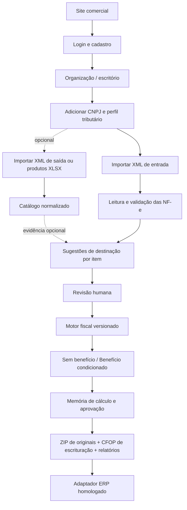

# COMANDO MESTRE — PORTAL INTELIGENTE DE DIFAL

**Versão:** 1.0 — 10/11/2026  
**Objetivo:** especificação e prompt executável para um agente de desenvolvimento de software (ex.: Codex, Cursor, Lovable, Bolt ou equipe técnica).  
**Status tributário:** especificação funcional; motor fiscal depende de validação das regras por UF, vigência e da planilha de cálculo que será fornecida pelo responsável tributário. Não tratar valores ou alíquotas de demonstração como regras legais.

---

## 1. PROMPT MESTRE — COPIAR E COLAR NO AGENTE DE DESENVOLVIMENTO

> Atue como uma equipe de engenharia sênior composta por arquiteto de software SaaS, especialista em segurança e proteção de dados, desenvolvedor full-stack TypeScript, engenheiro de dados fiscais de NF-e e analista de regras tributárias brasileiras. Desenvolva um **SaaS fiscal multiempresa, multiusuário e multitenant**, com cobrança recorrente, denominado provisoriamente **Portal Inteligente de DIFAL**.
>
> **Forma de trabalhar:** implemente de maneira incremental, produzindo código real, banco de dados, migrações, testes, documentação de execução, preview navegável e instruções de implantação. Comece pelo MVP funcional. Não trate protótipo visual como sistema completo. Não anuncie funcionalidades como prontas se faltar persistência, autorização, regras fiscais comprovadas, testes ou integração.
>
> **Princípio fiscal inegociável:** a plataforma **sugere a destinação** da compra e calcula o diferencial de alíquotas segundo regras versionadas, mas a decisão final sobre classificação e benefício fiscal pertence ao cliente ou profissional habilitado. A IA nunca deve inventar NCM, alíquotas, reduções de base, CFOP, fundamento legal ou memória de cálculo. Na ausência de dados verificáveis, retornar **"pendente de validação"**, com justificativa e campos faltantes. As regras aritméticas devem ser determinísticas, auditáveis e reproduzíveis, separadas do modelo de linguagem.
>
> **Mercado inicial:** empresas e escritórios de contabilidade com operações no Brasil, iniciando pelo estado do Rio de Janeiro (RJ), mas com arquitetura apta a acrescentar outras UFs sem reescrever o motor.

### A. Interface e experiência do usuário

> - Criar landing page comercial clara e profissional, com apresentação, benefícios, demonstração, planos, perguntas frequentes, segurança, contato, termos e botão **"Teste gratuito"**.
> - Idioma pt-BR; moeda BRL; datas dd/mm/aaaa; máscara de inscrição estadual quando aplicável; fuso configurável; interface responsiva e acessível.
> - Identidade visual de software contábil sério: branco, azul-petróleo, cinza, verde discreto para resultados aprovados. Evitar design excessivamente promocional.
> - Menu depois do login: **Painel**, **Minhas empresas**, **Importar entradas**, **Importar saídas**, **Base de produtos**, **Análises e revisão**, **Cálculo do DIFAL**, **Exportações**, **Assinatura**, **Configurações**.
> - Fluxo rápido recomendado: cadastro → empresa → atividades → importar XML de entrada → identificar itens → revisar → calcular → exportar.
> - A ausência de XML de saída e de cadastro de produtos **nunca deve impedir** análise de XML de entrada; apenas reduzir o grau de confiança e aumentar os itens para revisão.
> - Criar dados fictícios de demonstração, claramente identificados como fictícios.

### B. Autenticação, usuários e organizações

> - Oferecer cadastro como **Escritório contábil** ou **Empresa / profissional autônomo**, com e-mail verificado, senha segura, recuperação de acesso e autenticação multifator opcional/implementável.
> - Cada conta comercial cria um `tenant`/organização. Permitir papéis `owner`, `admin`, `analyst`, `reviewer`, `billing` e `read_only` com permissões testadas no servidor.
> - Permitir equipes pagas com múltiplos usuários, cada um com login próprio; proibir compartilhamento de senha como modelo de uso.
> - Aceitar CNPJ numérico e **alfanumérico**, conforme regra da Receita Federal em vigor desde 2026. Guardar identificador normalizado em campo textual de 14 caracteres, preservando zeros à esquerda. Validar dígitos conforme especificação vigente; nunca usar campos SQL numéricos para CNPJ.
> - Na avaliação gratuita, permitir **exatamente três estabelecimentos/CNPJs distintos por organização** e **cinco NF-e de entrada válidas e únicas por estabelecimento**, totalizando até 15 NF-e. Contabilizar por chave de acesso e CNPJ destinatário. Reimportações da mesma chave não consomem cota; arquivos ilegíveis, duplicados ou não pertinentes não consomem cota.
> - Os três CNPJs ficam **vinculados à conta para fins de cota de teste**; impedir substituição pelo próprio usuário apenas para reiniciar quotas. Permitir exclusão/anonimização de dados pessoais conforme política de retenção, sem conceder reposição automática da cota. Correções cadastrais legítimas exigem atendimento administrativo, justificativa e trilha de auditoria.
> - Bloquear quotas em transações atômicas no backend/banco de dados, não somente na tela. Não impor unicidade global do CNPJ: uma mesma empresa pode ser atendida por mais de um escritório, com isolamento e permissões.
> - Pedir declaração de autorização do escritório para tratar documentos de seus clientes. Aplicar termos de uso e política de privacidade.

### C. Cadastro de empresa e contexto operacional

> O usuário deverá informar ou confirmar:
>
> - Cartão do CNPJ em PDF (opcional quando dados forem consultados por fonte oficial ou inseridos manualmente), CNPJ, razão social, nome fantasia, UF, município e inscrição estadual.
> - CNAE principal e secundários (dados oficiais quando disponíveis), mas sem presumir a finalidade de cada item apenas pelo CNAE.
> - Regime tributário, na competência do documento: Simples Nacional, regime normal, outros. Situação de contribuinte de ICMS por estabelecimento e possíveis tratamentos especiais.
> - Setores selecionáveis por cartões/ícones: comércio varejista, atacado, indústria, alimentos, serviços, transportes, saúde, construção, agronegócio, comércio eletrônico e outros.
> - Atividades efetivas: revende mercadorias? fabrica? utiliza matéria-prima? comercializa equipamentos? presta serviços? recebe mercadoria para industrialização? possui bens de ativo imobilizado? opera com mercadorias sujeitas a ST? vende o mesmo item que utiliza internamente?
> - Perfil pode ser modificado com versionamento e validade a partir da competência, sem alterar silenciosamente cálculos históricos aprovados.
> - Criar formulário de decisões adicionais por produto ambíguo: **revenda, matéria-prima/insumo, embalagem, uso e consumo, ativo imobilizado, outra destinação, não sei**.

### D. Importação de XML de entradas

> - Suportar upload múltiplo de XMLs NF-e modelo 55 (`nfeProc` e estruturas oficiais válidas), e ZIP de XMLs. Definir limites por arquivo e lote, exibidos ao usuário; tratar lote assíncrono com barra de progresso.
> - Ler por item: chave da NF-e, modelo, série, número, emissão, entrada, emitente, destinatário, UF de origem/destino, CFOP informado pelo emissor, descrição, `cProd`, `cEAN/GTIN`, NCM, CEST quando houver, quantidade, valor unitário, valor do produto, descontos, frete, seguro, outras despesas, IPI, campos de ICMS, ICMS ST/FCP quando houver, situação tributária, protocolo e referências.
> - Validar destinatário contra CNPJ do estabelecimento selecionado, CFOP/UF e consistência estrutural do XML. Tratar diferenças entre NF-e, NFC-e, NFSe e outros modelos como erros claros de escopo, não importar silenciosamente.
> - Guardar arquivo original **imutável**, sem reformatação, e seu SHA-256. Tratar duplicidade por `(tenant_id, company_id, access_key)` com política para eventos e reenvios.
> - Ler eventos de cancelamento quando fornecidos; não assumir que uma nota continua válida apenas porque o XML original contém protocolo autorizado. Separar status de documento de status de análise.
> - XML malformado, ausência de campos, itens sem NCM, operações que não sejam compras interestaduais, CFOPs especiais, bonificações, devoluções, transferências e operações simbólicas devem receber triagem específica.
> - Proteger contra XML External Entity (XXE), entity expansion, zip bomb, zip slip, caminhos inválidos e arquivos disfarçados. Nunca executar conteúdo enviado.
> - A lógica deve funcionar sem catálogo de vendas prévio, com avisos de confiança.

### E. Base de produtos e importação de saídas

> - Módulo **"Importar saídas"** visível ao lado de **"Importar entradas"**; importação facultativa.
> - Aceitar XMLs de saídas e planilha Excel (.xlsx) de cadastro de produtos; fornecer modelo baixável com colunas `codigo_interno`, `descricao`, `ncm`, `cest`, `gtin`, `categoria`, `finalidade_padrao`, `observacoes`.
> - Extrair catálogo normalizado por empresa/estabelecimento; preservar histórico e fonte (`xml_saida`, `xlsx`, `validacao_manual`).
> - Duplicatas não devem criar novos itens quando houver correspondência segura de SKU/GTIN e demais atributos. Divergência de NCM/descrição deverá gerar aviso.
> - Correspondência por código interno/fornecedor, GTIN, NCM, descrição normalizada e sinônimos, priorizando informações específicas sobre genéricas. NCM isolado jamais determina revenda ou consumo.
> - Produtos vendidos também podem ser usados internamente: nunca proibir a classificação `uso e consumo` só por haver venda do mesmo NCM/SKU.
> - Histórico de classificações **aprovadas** pode melhorar sugestões para o mesmo cliente, respeitando isolamento entre organizações. Qualquer compartilhamento global de dados entre clientes depende de base legal/autorizações e anonimização apropriada.

### F. Classificação inteligente por ITEM

> Criar pipeline explicável com:
>
> 1. Identificar natureza documental: entrada interestadual, interna, devolução, retorno, remessa, bonificação, compra de ativo, operações com ST ou outra.
> 2. Relacionar atividade e perfil da adquirente na competência.
> 3. Consultar cadastro de produtos de saída quando disponível.
> 4. Considerar NCM completo, capítulo/posição/subposição apenas como evidência de categoria; conferir descrição real, SKU/GTIN, fornecedor e contexto.
> 5. Aplicar decisões de itens idênticos anteriormente aprovadas por aquele estabelecimento; priorizar aprovação específica mais recente.
> 6. Produzir classificação sugerida: `revenda`, `industrializacao_insumo`, `embalagem`, `uso_consumo`, `ativo_imobilizado`, `outras_operacoes`, `indeterminado`.
> 7. Produzir `confidence_score` e *motivos objetivos* para cada decisão; `confidence_score` mede confiança da classificação e NÃO probabilidade legal de incidência tributária.
> 8. Exigir confirmação para situações ambíguas e benefícios fiscais; permitir edição em massa, mas sempre no nível de cada item de NF-e, preservando justificativas.
>
> **Exemplo:** loja de vestuário adquire vassoura de outro estado → sugestão forte de uso e consumo; mercadoria da própria linha vendida regularmente → sugestão de revenda, mas mostrar possibilidade de consumo interno; equipamentos de alto valor → indício de ativo, sujeito à confirmação. **Nunca classificar automaticamente só pelo capítulo NCM.**

### G. Motor fiscal do DIFAL — separação obrigatória

> - Criar módulo específico **`difal_aquisicao_consumidor_final_contribuinte`** para entrada interestadual de mercadoria destinada a uso/consumo ou ativo imobilizado por contribuinte de ICMS.
> - Deixar **`difal_venda_consumidor_final_nao_contribuinte`** como módulo distinto e desabilitado no MVP. São hipóteses, responsáveis, bases e fluxos diferentes. Não misturar as duas modalidades nem aplicar uma única fórmula universal.
> - Separar, conforme caso, **DIFAL próprio na entrada**, **DIFAL-ST de mercadorias sujeitas à substituição tributária**, FECP/FCP e recolhimentos já realizados na origem/destino; evitar duplicidade de tributos.
> - Usar `Decimal`/aritimética decimal de precisão definida; proibir `float` como fonte de valores fiscais. Implementar estratégia explícita de arredondamento por item, documento e apuração, de acordo com regras versionadas e a planilha de referência aprovada. Registrar cada operação intermediária.
> - Entradas: UF de origem e destino, competência, regime, CFOP de emissão, CFOP sugerido de escrituração, NCM/CEST, finalidade, valor e composição da operação, ICMS próprio da origem e alíquota, alíquota interna de destino, eventual base reduzida, IPI, frete, desconto, FECP, ST, responsabilidades e fundamentação jurídica.
> - Motor deve ter tabelas versionadas `tax_rule`, `tax_rate`, `tax_benefit`, `tax_formula`, `tax_source`, com `effective_from` e `effective_to`, UF, condições, exceções, fonte normativa e status de revisão por responsável fiscal.
> - Não preencher regra faltante com valores padrão não validados; não usar valor exibido em tela de exemplo como base para produção.
> - Respeitar hipóteses de não incidência, isenção, exclusão, recolhimento anterior, benefício condicionado, alíquota interestadual aplicável e diferenças de regime. Quando não for possível determinar, retornar análise **pendente**, jamais `R$ 0,00` por falta de dado.
> - Considerar que o RJ utiliza em determinadas entradas uma recomposição da base de cálculo por dentro; o Manual de Substituição Tributária do RJ apresenta fórmula de DIFAL-ST para seu âmbito. **Não generalizar essa fórmula para todas as situações sem homologação do enquadramento.**
> - Separar o resultado em **ICMS-DIFAL**, **FECP**, **total**, **base**, **alíquotas**, **modalidade**, **benefício**, **fundamentos normativos** e **versão da regra**.
> - Tratar benefício por **produto + descrição + operação + origem/destino + condição do contribuinte + destinação + vigência + exceções**, não apenas NCM. A redução de base na operação interestadual não implica necessariamente DIFAL zero; avaliar incidência e efeitos específicos no caso concreto.
> - Para candidatos a benefício, apresentar **cenário A sem benefício** e **cenário B com benefício condicionado**, com fundamento, diferenças numéricas e checklist documental para o usuário confirmar. O cenário B nunca deve ser tratado como valor definitivo sem elegibilidade confirmada.
> - Permitir substituir parâmetros faltantes por inserção manual identificada como **premissa do usuário**, sem transformá-la em regra oficial.
> - Permitir plugar posteriormente uma planilha fiscal oficial de cálculo fornecida pelo proprietário como conjunto de casos de teste e referência para homologação, preservando particularidades por UF e período.
> - Planejar suporte futuro à tributação de IBS/CBS, mas **não somar IBS/CBS ao DIFAL do ICMS nem implementar regras de 2027 no MVP sem uma especificação independente**.

### H. Motor de decisões para CFOP de escrituração

> - Diferenciar `issuer_cfop` (campo intocável no XML emitido pelo fornecedor) de `bookkeeping_cfop` (proposto para registro de entrada pelo destinatário).
> - Usar tabela de correspondência de CFOP **versionada**, levando em conta UF, operação, finalidade, ST, origem, aquisição para revenda, industrialização, consumo ou ativo.
> - Exemplos meramente ilustrativos de CFOP para entrada de outra UF: `2.102` compra para comercialização, `2.556` uso/consumo, `2.551` ativo imobilizado. **Esses códigos não são uma regra universal** e podem existir outros códigos mais específicos.
> - O profissional confirma o CFOP de escrituração por item; não sobrescrever `issuer_cfop`; guardar autor, data e justificativa da alteração e todas as versões.
> - Exportar apenas itens e documentos aprovados, salvo quando usuário escolher relatório de pendências. Se nota mista, indicar CFOP de escrituração distinto por item quando cabível.

### I. Exportação e integração contábil — requisito crítico

> **Nunca alterar o XML fiscal autorizado para simular um documento oficial atualizado.** A NF-e tem assinatura digital do emitente e autorização da SEFAZ vinculada ao conteúdo original. Alterá-la invalida a assinatura/autorização.
>
> Criar recurso **"Exportar para escrituração"** que monte ZIP com:
>
> - `/originais/`: XMLs originais autorizados, **sem qualquer alteração de conteúdo**.
> - `/mapeamento_cfop/entrada_itens.csv`: chave de acesso, número/série, CNPJ, número do item, descrição, NCM, CFOP de emissão, CFOP de entrada aprovado, destinação, justificativa, revisão e usuário aprovador.
> - `/apuracao/memoria_calculo.csv` e `/apuracao/demonstrativo.xlsx`: bases, ICMS, FECP, cenários e regra normativa por item/documento.
> - `/auditoria/manifesto.json`: versão da plataforma/regra, hashes dos originais, data/hora, decisões e status.
> - `/pendencias/itens_nao_aprovados.csv`: itens que exigem revisão.
> - `/erp/`: adaptador opcional para o **layout de importação do ERP que o cliente utiliza**, começando pelo sistema que o proprietário escolher. Só habilitar compatibilidade após receber arquivo de exemplo/layout técnico e executar testes reais de importação.
>
> Se um ERP aceitar XML **de dados de importação próprios**, fora do leiaute de NF-e oficial, o adaptador poderá gerar esse XML identificando claramente que é **arquivo auxiliar de escrituração**, nunca NF-e autorizada. Não gerar `nfeProc` com campo `det/prod/CFOP` adulterado e apresentá-lo como original válido. Bloquear qualquer exportação que induza a esse equívoco.
>
> Interface de exportação: escolher empresa, competência, notas aprovadas, ERP, formato e clique `Gerar ZIP`. Exibir relatório de validação antes do download.

### J. Relatórios e painel

> - Painel por organização e estabelecimento com total de XMLs, itens, valores de notas, itens classificados, itens pendentes, provável DIFAL, DIFAL homologado, FECP, benefícios em análise e total a recolher quando aprovados.
> - Diferenciar visualmente `estimado`, `aprovado`, `pendente` e `não aplicável`; não rotular total de hipóteses como obrigação fiscal confirmada.
> - Filtros: competência, UF de origem, fornecedor, NCM, CFOP, categoria, situação, cenário tributário, revisão e reimportação.
> - Histórico de análises e comparação entre versões de regra. Permitir reprocessamento versionado mediante confirmação, preservando apuração anterior.
> - Exportar CSV/XLSX e gerar PDF de relatório apenas quando implementado conforme layout desejado.

### K. Assinaturas e avaliação gratuita

> - Implementar planos configuráveis por administrador: `trial`, `starter`, `accounting`, `business` e `enterprise`.
> - Para `trial`: 3 CNPJs vinculados, 5 NF-e de entrada distintas por CNPJ; limite vitalício por organização para evitar reiniciar cotas; sem exigência inicial de cartão, se comercialmente desejado.
> - Planos pagos: quotas por CNPJ, volume mensal de XML processado, número de usuários, exportações e suporte. Nunca apagar documentos durante alteração/cancelamento sem aplicar política de retenção.
> - Integrar gateway de recorrência disponível no Brasil, preferencialmente Mercado Pago Assinaturas (ou Stripe Billing como alternativa). Implementar **webhooks com autenticação/verificação, idempotência, retries, reconciliação e estados** `active`, `past_due`, `canceled`, `trialing`, `unpaid`.
> - A concessão de acesso pago deve vir de evento confirmado no backend, e não da tela de checkout ou de um parâmetro de URL.
> - Criar páginas para upgrade/downgrade, histórico de pagamentos, cancelamento e administração de quotas.

### L. Segurança, privacidade e dados fiscais

> - Autenticação robusta, RBAC, RLS (Row Level Security) no PostgreSQL e isolamento de `tenant_id` em todas as tabelas que contêm dados de clientes. Testes negativos devem provar que organização A jamais lê ou altera documento da organização B.
> - `tenant_id` é derivado da sessão/autorização no servidor, não confiado do corpo JSON enviado pelo usuário.
> - Arquivos em storage privado, objetos por organização, URLs assinadas de curta duração, criptografia em trânsito/repouso, logs de auditoria, backups e retenção configurável.
> - Arquivos, XMLs e dados de empresas nunca serão enviados a provedor de IA externo sem configuração contratual e autorização adequadas. Implementar classificador inicial por regras determinísticas, com IA opcional para sugestão sem identificar dados pessoais desnecessários.
> - Implantar limite de uploads, antiabuso, proteção contra enumeração de CNPJs, verificação de conteúdo e testes de segurança de APIs, incluindo acesso direto a documentos de outros usuários (IDOR).
> - Aplicar LGPD às informações de pessoas naturais eventualmente presentes nos arquivos e aos dados de acesso. Criar termos, política de privacidade, registros de tratamento, exclusão e procedimentos para incidentes.
> - Registrar fontes e versões normativas, responsável por homologação fiscal, data de atualização e logs de mudança.

### M. Arquitetura sugerida

> - Frontend/backend web: **Next.js + TypeScript + Tailwind CSS**, com componentes acessíveis e separação de domínio.
> - Banco: **PostgreSQL**, preferencialmente Supabase para acelerar Auth/Storage/RLS no MVP.
> - Processamento assíncrono de lotes: workers Node.js e fila confiável (Redis/BullMQ ou serviço gerenciado equivalente) quando volume exigir.
> - Parser de XML seguro com suporte às estruturas da NF-e. Cálculos com biblioteca decimal (ex.: `decimal.js`).
> - Upload privado em object storage; checksum SHA-256 e metadados em PostgreSQL.
> - Cobranças: abstração `BillingProvider` para permitir trocar o gateway sem reescrever planos.
> - Regras tributárias independentes da UI, com schemas versionados e testes de casos.
> - Docker Compose para ambiente local, `.env.example` sem segredos, migrações SQL/versionadas, script `seed:demo`, testes unitários/integrados e CI.
> - Não depender exclusivamente de APIs pagas para executar cálculo fiscal. Se cadastro CNPJ externo ficar indisponível, permitir conferência manual e registrar origem do dado.

### N. Esquema de dados mínimo

> Criar migrações para as tabelas abaixo com PK, FK, índices, timestamps, `tenant_id` onde aplicável e RLS. Adaptar nomes conforme convenção sem perder entidades:
>
> 1. `organizations`, `organization_users`, `roles`, `user_profiles`.
> 2. `subscriptions`, `plans`, `plan_limits`, `usage_counters`, `billing_events`, `trial_company_slots`.
> 3. `companies` (estabelecimentos), `company_activity_profiles`, `company_tax_profiles`, `company_permissions`.
> 4. `products`, `product_aliases`, `product_sources`, `product_classification_history`.
> 5. `import_batches`, `source_documents`, `invoice_headers`, `invoice_items`, `invoice_events`, `import_errors`.
> 6. `item_classification_suggestions`, `item_reviews`, `item_final_classifications`.
> 7. `tax_rules`, `tax_rule_conditions`, `tax_rates`, `tax_benefits`, `tax_formulas`, `tax_sources`, `tax_rule_versions`.
> 8. `tax_runs`, `tax_item_results`, `tax_scenarios`, `tax_calculation_steps`, `tax_reviews`, `tax_run_approvals`.
> 9. `cfop_mapping_rules`, `item_bookkeeping_cfop`, `erp_adapters`, `export_jobs`, `export_manifests`.
> 10. `audit_events`, `user_consents`, `data_retention_requests`.
>
> Use valores monetários e percentuais com tipos de precisão exata, `numeric` no banco e decimal no código. CNPJ e chave de acesso são strings (nunca números). Imutabilidade lógica para originais, hashes e histórico de decisão. Indexar `tenant_id`, `company_id`, `access_key`, `issued_at`, `ncm`, `status`, `tax_rule_version_id`.

### O. APIs e operações

> Definir rotas autenticadas, validadas com schema e política de papéis:
>
> - `POST /api/auth/*` conforme provedor de autenticação.
> - `GET|POST /api/companies`; `GET|PATCH /api/companies/:id`.
> - `POST /api/imports/entries`; `POST /api/imports/exits`; `POST /api/imports/product-sheet`; `GET /api/imports/:id/status`.
> - `GET /api/products`; `PATCH /api/products/:id`.
> - `GET /api/analysis/:companyId`; `POST /api/analysis/:batchId/reprocess`.
> - `POST /api/items/:id/classification/review`; `POST /api/items/:id/cfop/approve`.
> - `POST /api/tax-runs`; `GET /api/tax-runs/:id`; `POST /api/tax-runs/:id/approve`.
> - `POST /api/exports`; `GET /api/exports/:id/status`; `GET /api/exports/:id/download`.
> - `GET /api/plans`; `POST /api/billing/checkout`; `POST /api/billing/webhook`; `GET /api/billing/subscription`.
> - Rotas administrativas separadas para manutenção/homologação de regras e plano; não expor esses endpoints a analistas comuns.
> - Todas as operações mutáveis devem ter logs de auditoria e controle de idempotência onde necessário.

### P. Testes e critérios objetivos de aceite

> **Cenário 1:** escritório cria conta trial e cadastra três CNPJs. Quarto CNPJ é bloqueado no backend; tentar apagar e cadastrar outro para reiniciar trial não libera nova vaga.
>
> **Cenário 2:** cada empresa importa cinco NF-e válidas e distintas; sexta nota é bloqueada. Reupload de chave já importada não consome cota e não duplica análises.
>
> **Cenário 3:** lojista de roupas importa NF-e de vassouras sem base de saída; sistema sugere uso/consumo, explica evidências e oferece revisão. Cálculo não é finalizado sem parâmetros fiscais homologados.
>
> **Cenário 4:** o mesmo item pode ser vendido e também usado internamente; cadastro de saídas não impõe revenda automaticamente.
>
> **Cenário 5:** NF-e de múltiplos itens com destinos diversos permite classificações e CFOPs de escrituração diferentes por item.
>
> **Cenário 6:** uma NF-e interna no RJ não recebe DIFAL interestadual; operações especiais e casos com ST são triados corretamente.
>
> **Cenário 7:** sem alíquota interna válida, fundamento de benefício ou informação essencial, o sistema apresenta **"pendente"**, não `0` nem um valor fictício.
>
> **Cenário 8:** candidatos à redução mostram cálculo A sem benefício e B condicionado, com fonte, vigência e diferença, exigindo confirmação.
>
> **Cenário 9:** resultado de cálculo apresenta base, percentuais, ICMS, FECP, modo, fórmula, arredondamento e fonte legal; reprocessamento preserva versão anterior.
>
> **Cenário 10:** ZIP de exportação inclui XML original intacto com hash idêntico ao de importação e mapeamento do CFOP de escrituração em arquivo separado. Nenhum XML alterado é apresentado como NF-e original autorizada.
>
> **Cenário 11:** conta de outra organização não pode consultar empresa, XML, processamento, exportação ou fatura de um cliente alheio, inclusive alterando IDs diretamente na URL/API.
>
> **Cenário 12:** CNPJs com letras e números são cadastrados e aceitos conforme as regras oficiais vigentes.
>
> **Cenário 13:** webhooks repetidos/de outra assinatura não duplicam cobrança nem liberam acessos indevidos.
>
> **Cenário 14:** XLSX de catálogo e ZIP de XML malformados falham com mensagem útil, sem vazamento de dados e sem consumirem cota indevida.
>
> **Cenário 15:** todos os cálculos exigidos passam em testes regressivos confrontando a planilha oficial fornecida posteriormente, com tolerâncias e política de arredondamento documentadas.

### Q. Entregas obrigatórias do agente

> Ao concluir cada etapa, entregue:
>
> 1. Código versionado, estrutura das pastas e dependências.
> 2. Migrations e instruções para criar banco seguro.
> 3. URLs/telas navegáveis com backend real para funções implementadas.
> 4. `.env.example` e instruções de configuração de credenciais sem publicar segredos.
> 5. Testes automatizados e resumo dos testes aprovados.
> 6. Lista franca do que **está funcional**, **é demonstração** e **precisa de homologação fiscal/integração com ERP**.
> 7. Comandos exatos para instalar, executar localmente, testar e implantar.
> 8. Demonstração do fluxo completo com dados fictícios, sem apresentar simulações como débitos fiscais de clientes reais.
>
> **Comece imediatamente pelo Sprint 1**: landing page, autenticação, organizações/empresas, cadastro tributário, quotas trial no backend, upload e parsing seguro de XML de entrada, tela por itens e sugestões iniciais com dados fictícios. Em seguida, execute sprints sequenciais até as funcionalidades finais; não tente automatizar cálculo legal definitivo antes de homologação das regras.

---

## 2. PROMPTS DE CONTINUAÇÃO POR ETAPA

Usar um de cada vez caso o desenvolvedor/agente prefira tarefas menores.

### Etapa 1 — SaaS, cadastro e teste gratuito

```
Implemente o Sprint 1 do Portal Inteligente de DIFAL descrito no COMANDO MESTRE. Entregue landing page, login, tenant e usuários, cadastro de CNPJ numérico/alfanumérico, perfil de atividade, trial permanente com 3 CNPJs e 5 NF-e válidas por CNPJ, isolamento RLS, banco/migrations, upload seguro e listagem básica de itens lidos de XML real. Crie testes e um preview funcional. Mostre como executar e o que ainda é simulação.
```

### Etapa 2 — Catálogo e sugestões

```
Implemente a importação opcional de XMLs de saída e de catálogo XLSX, normalização de produtos, vínculos por SKU/GTIN/NCM/descrição e classificador explicável de destinação por item. Nunca exigir catálogo prévio para análise de entrada. Adicione revisão humana, aprendizagem apenas por decisões aprovadas do próprio tenant e testes que comprovem que produto vendido também pode ser usado internamente.
```

### Etapa 3 — Motor tributário

```
Implemente o motor fiscal versionado do DIFAL de aquisição interestadual para uso/consumo e ativo por contribuinte no RJ, isolando tratamento DIFAL próprio, DIFAL-ST, FECP e benefícios, conforme planilha fiscal e atos normativos que serão anexados. Antes da implementação definitiva, gere matriz de decisão e liste parâmetros sem fonte. Não invente alíquotas, fundamentos ou cálculos. Entregue memória de cálculo determinística, Decimal, cenários sem/com benefício condicionado, aprovação, auditoria e testes por competência.
```

### Etapa 4 — CFOP e exportações

```
Implemente CFOP de escrituração por item, separado do CFOP da NF-e emitida, com aprovação humana e trilha de auditoria. Exporte ZIP com XMLs originais imutáveis, CSV de mapeamento aprovado por item, memória de cálculo, manifesto de hashes e pendências. Não adulterar XML assinado. Crie interface e contrato para adaptador do primeiro ERP, mas só declarar compatibilidade após receber layout real e passar em teste de importação.
```

### Etapa 5 — Assinaturas e publicação

```
Integre pagamentos recorrentes com Mercado Pago Assinaturas usando back-end seguro, webhooks verificados/idempotentes, plano e quotas auditáveis, upgrade/downgrade, cancelamento e controles de não pagamento. Implante ambiente de homologação, CI, backup e alertas; realize testes de isolamento multi-tenant, carga, segurança do upload e proteção contra reuso do trial. Entregue checklist de publicação e operação mensal.
```

---

## 3. FLUXO DO PRODUTO — REVISADO



---

## 4. REGRAS ESSENCIAIS DE NEGÓCIO

| Regra | Especificação |
|---|---|
| Trial de 3 clientes | Limite único por organização, de 3 CNPJs vinculados, controlado no servidor e auditável |
| Cinco XMLs | Limite por CNPJ de 5 chaves distintas de NF-e de entrada válidas; não contar duplicatas |
| Base de saída | Sempre opcional; acrescenta evidência mas não define destinação isoladamente |
| Classificação | Item a item, com explicação, revisão e histórico |
| DIFAL | Apenas situações confirmadas; hipóteses e pendências diferenciadas |
| Redução de base | Critérios legais por operação/mercadoria/contribuinte/vigência, com dois cenários condicionais |
| FECP | Cálculo segregado e coerente com a base e exceções aplicáveis; evitar duplicidade |
| CFOP | `issuer_cfop` é original; `bookkeeping_cfop` é proposto/aprovado pelo destinatário |
| Exportação | XML original intocado + mapeamento/arquivo auxiliar de escrituração + relatório auditável |
| Dados | Isolamento por tenant, criptografia, retenção, controles de acesso e trilha |
| Receita recorrente | Assinaturas e quotas implementadas no servidor, webhooks idempotentes |
| Legislação | Regras com validade por data e UF; não confundir legislação presente com períodos anteriores |

---

## 5. MATRIZ FISCAL — PONTOS PARA HOMOLOGAÇÃO DO PROPRIETÁRIO

A planilha de cálculo e o responsável tributário devem validar, para cada competência/UF:

1. Qual a situação fiscal do destinatário (contribuinte de ICMS, Simples, regime normal etc.)?
2. A operação é interestadual e efetivamente de compra, ou remessa, retorno, devolução, bonificação, transferência etc.?
3. A destinação é uso e consumo, ativo imobilizado, industrialização/insumo, revenda ou outra?
4. A operação está sujeita a substituição tributária? Quem é o responsável pelo diferencial? Já existe recolhimento relevante?
5. Qual a alíquota interestadual aplicável (origem, destino e particularidades do produto/origem estrangeira)?
6. Qual a alíquota interna do destino na data do fato gerador? Como o FECP afeta a operação?
7. Quais parcelas integram a base (produto, frete, IPI, despesas, desconto, ICMS destacado etc.) e por quê?
8. Qual fórmula legal se aplica ao caso: base única, recomposição por dentro, DIFAL-ST ou outra?
9. Há redução de base/isenção/benefício pertinente, com vigência, condições e exceções comprovadas?
10. Qual momento de arredondamento por item/documento/período e forma de apuração?
11. Há ICMS/FECP já recolhido ou responsabilidade de terceiro que impeça duplicidade?
12. Qual CFOP de escrituração é apropriado, conforme finalidade, origem e regime?
13. Qual memória de cálculo e fonte normativa sustenta a conclusão?
14. Quais lançamentos e códigos devem ser oferecidos no relatório para o regime/UF (sem geração automática de EFD não homologada)?

**Regra de bloqueio:** ausência de informação essencial = `pendente de validação`; não gerar automaticamente imposto igual a zero nem afirmar não incidência.

---

## 6. PLANO DE ENTREGAS E MODELO COMERCIAL

**MVP comercial inicial:** landing page → onboarding → 3 CNPJs trial → importação de XML entrada → classificação e revisão por item → cálculo RJ com planilha homologada → relatório/exportação de mapeamento → assinatura.

**Fase posterior:** catálogo de saídas avançado, muitos XMLs, aprendizado por histórico, mais UFs, integrações ERP específicas, área de equipe, automações de escritório e APIs.

**Precificação inicial a testar (não é pesquisa de mercado):**

| Plano experimental | Capacidade ilustrativa | Faixa a testar |
|---|---|---|
| Gratuito | 3 CNPJs fixos, 5 NF-e por CNPJ, sem prazo obrigatório | R$ 0 |
| Inicial | 1 a 3 CNPJs, volume pequeno | R$ 99–149/mês |
| Escritório | Até 10 CNPJs, volume intermediário | R$ 249–399/mês |
| Profissional | Até 30 CNPJs, mais volume e equipe | R$ 599–899/mês |
| Personalizado | Alto volume e integração ERP | Sob proposta |

A precificação efetiva exige medir despesas de infraestrutura, processamento, suporte, atualizações fiscais e disposição a pagar dos primeiros usuários. Priorizar cobrança por CNPJ e volume de XML, não apenas número de logins.

---

## 7. FONTES PRIMÁRIAS PARA DOCUMENTAÇÃO E VALIDAÇÃO

- **Portal Nacional da NF-e — perguntas frequentes:** XML de NF-e autorizada não pode ser alterado sem invalidar assinatura e autorização: <https://www.nfe.fazenda.gov.br/Portal/perguntasFrequentes.aspx?AspxAutoDetectCookieSupport=1&tipoConteudo=auR4yGlWmRY%3D>
- **SEFAZ/RJ — Consulta Tributária 069/2024:** distinção de base/cálculo para entrada interestadual de uso e consumo/ativo e saída a consumidor final: <https://portal.fazenda.rj.gov.br/consulta-tributaria/wp-content/uploads/sites/45/2024/10/069_2024.pdf>
- **SEFAZ/RJ — Manual de Substituição Tributária (consultar versão/atualizações):** fórmula e hipóteses de DIFAL-ST: <https://portal.fazenda.rj.gov.br/icms/wp-content/uploads/sites/42/2023/10/ManualSubstTribut.pdf>
- **SEFAZ/RJ — Manual EFD ICMS/IPI (edição 28/03/2025):** seção 2.15, escrituração de DIFAL e FECP em entradas de uso/consumo e ativo: <https://portal.fazenda.rj.gov.br/efd/wp-content/uploads/sites/32/2023/09/Manual_EFD.pdf>
- **SEFAZ/PE — Tabela de CFOP (validar vigência para operações atuais):** <https://www.sefaz.pe.gov.br/legislacao/tributaria/documents/legislacao/tabelas/cfop.htm>
- **Receita Federal — CNPJ alfanumérico:** <https://www.gov.br/receitafederal/pt-br/assuntos/noticias/2026/julho/receita-federal-gera-o-primeiro-cnpj-em-formato-alfanumerico>
- **Receita Federal — Consulta de CNPJ:** <https://www.gov.br/pt-br/servicos/consultar-cadastro-nacional-de-pessoas-juridicas>
- **Mercado Pago Developers — Assinaturas:** <https://www.mercadopago.com.br/developers/pt/docs/subscriptions/overview>
- **Supabase — Row Level Security:** <https://supabase.com/docs/guides/database/postgres/row-level-security>
- **ANPD — Perguntas Frequentes LGPD:** <https://www.gov.br/anpd/pt-br/acesso-a-informacao/perguntas-frequentes>

**Atenção:** fontes antigas ou manuais de referência não provam, por si, vigência na competência analisada. Criar processo recorrente de verificação de atos novos e homologação pela equipe fiscal.

---

## 8. DADOS A FORNECER PARA HOMOLOGAÇÃO ANTES DO LANÇAMENTO

**Obrigatórios para homologação fiscal:**
- Planilha modelo com memória de cálculo do DIFAL e exemplos reais de cálculo já validados e anonimizados.
- Conjunto de XMLs de teste de entrada, com itens de revenda, uso/consumo, ativo, casos mistos, ST, benefício e exceções; dados pessoais e sensíveis tratados adequadamente.
- Lista de UFs atendidas no início: recomendamos RJ apenas para começar e expansão modular.
- Políticas específicas de cálculo/arredondamento/FECP e lista de atos normativos verificados.

**Obrigatórios para integração ERP:**
- Qual ERP será o primeiro (por exemplo: Domínio, Alterdata, TOTVS ou outro)?
- Arquivo de exemplo, documentação ou procedimento real aceito pelo ERP para CFOP de entrada por item.
- Teste de importação em ambiente controlado, confrontando os dados com os originais.

**Obrigatórios para operação SaaS:**
- Domínio do site, identidade visual, pessoa responsável pelo suporte, titularidade do gateway de pagamentos e termos jurídicos revisados.

---

**Critério final de sucesso:** o usuário consegue cadastrar empresa, importar XML de entrada sem catálogo de saída, receber sugestões por item, revisar a destinação, obter cálculo auditável de DIFAL quando todas as regras estiverem homologadas e baixar um ZIP próprio para escrituração **sem adulterar o documento fiscal original**.
